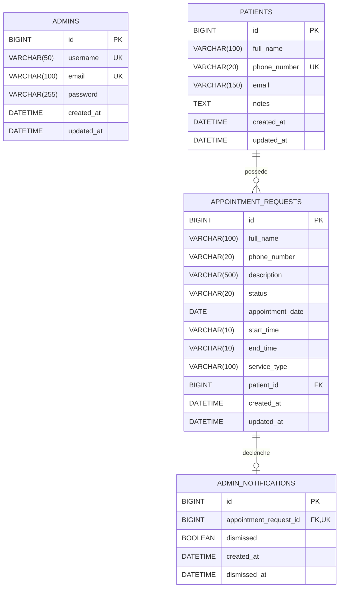

# Documentation de la Base de Données — MediCare Platform

Ce document décrit l'architecture relationnelle, le dictionnaire des tables, les index de performance et les procédures d'initialisation de la base de données **MediCare Platform** (MySQL 8.0+ / TiDB Serverless).

---

## 1. Schéma Entité-Association (ERD)



---

## 2. Dictionnaire des Tables

### 2.1 Table `admins`
Stocke les comptes autorisés à accéder au Dashboard d'administration.

| Colonne | Type | Nullable | Contraintes | Description |
| :--- | :--- | :---: | :--- | :--- |
| `id` | `BIGINT` | Non | Clé Primaire, Auto-incrémentée | Identifiant unique de l'administrateur |
| `username` | `VARCHAR(50)` | Non | Unique | Identifiant de connexion unique |
| `email` | `VARCHAR(100)` | Oui | Unique | Adresse e-mail de contact ou récupération |
| `password` | `VARCHAR(255)` | Non | Hash BCrypt (force 10) | Empreinte sécurisée du mot de passe |
| `created_at` | `DATETIME` | Non | Défaut: `CURRENT_TIMESTAMP` | Date et heure de création du compte |
| `updated_at` | `DATETIME` | Non | Défaut: `CURRENT_TIMESTAMP` | Date et heure de dernière modification |

---

### 2.2 Table `patients`
Répertoire médical simplifié des patientes du cabinet.

| Colonne | Type | Nullable | Contraintes | Description |
| :--- | :--- | :---: | :--- | :--- |
| `id` | `BIGINT` | Non | Clé Primaire, Auto-incrémentée | Identifiant patiente |
| `full_name` | `VARCHAR(100)` | Non | Min 2, Max 100 car. | Nom complet de la patiente |
| `phone_number` | `VARCHAR(20)` | Non | Unique, Indexé | Numéro de téléphone (clé métier d'identification) |
| `email` | `VARCHAR(150)` | Oui | — | Adresse e-mail de la patiente |
| `notes` | `TEXT` | Oui | — | Remarques administratives du médecin |
| `created_at` | `DATETIME` | Non | Défaut: `CURRENT_TIMESTAMP` | Date de première prise de contact |
| `updated_at` | `DATETIME` | Non | Défaut: `CURRENT_TIMESTAMP` | Date de dernière mise à jour |

*Index d'optimisation* :
- `idx_patient_phone` (`phone_number`) : Recherche rapide lors de la soumission de rendez-vous.
- `idx_patient_created` (`created_at`) : Tri chronologique dans le répertoire.

---

### 2.3 Table `appointment_requests`
Demandes de rendez-vous soumises par le formulaire public ou gérées par le cabinet.

| Colonne | Type | Nullable | Contraintes | Description |
| :--- | :--- | :---: | :--- | :--- |
| `id` | `BIGINT` | Non | Clé Primaire, Auto-incrémentée | Identifiant de la demande |
| `full_name` | `VARCHAR(100)` | Non | Min 2, Max 100 car. | Nom déclaré lors de la demande |
| `phone_number` | `VARCHAR(20)` | Non | Min 8, Max 20 car. | Téléphone de contact pour confirmation |
| `description` | `VARCHAR(500)` | Oui | Max 500 car. | Motif non sensible de la consultation |
| `status` | `VARCHAR(20)` | Non | Défaut: `'EN_ATTENTE'` | Statut (enum) : `EN_ATTENTE`, `CONFIRMEE`, `REFUSEE`. Contrainte CHECK présente dans le schéma SQL mais **non garantie sur TiDB Cloud Serverless** (voir note ci-dessous). La validation primaire est assurée par l'enum Java. |

> [!WARNING] Contrainte CHECK et TiDB Cloud Serverless
> La contrainte `CHECK (status IN ('EN_ATTENTE', 'CONFIRMEE', 'REFUSEE'))` est **parsée mais non forcément appliquée** sur TiDB Cloud Serverless.
>
> **Raison :** L'application de cette contrainte dépend de la variable système `tidb_enable_check_constraint`, qui est `OFF` par défaut. Sur TiDB Cloud Serverless, l'instruction `SET GLOBAL tidb_enable_check_constraint = ON` requiert des privilèges `SUPER` qui ne sont **pas accordés** aux utilisateurs de la tier gratuite.
>
> **Impact réel :** Nul en pratique. La validation des valeurs de statut est entièrement assurée par :
> 1. L'enum Java `AppointmentStatus` (`EN_ATTENTE`, `CONFIRMEE`, `REFUSEE`) — toute valeur hors-enum est rejetée par Spring Boot avant même d'atteindre la base de données.
> 2. La désérialisation Jackson qui refuse toute valeur inconnue avec une erreur HTTP 400.
> 3. Le type `@Enumerated(EnumType.STRING)` de Hibernate qui ne peut écrire que des valeurs valides.
>
> La contrainte CHECK reste dans le schéma pour MySQL/XAMPP local et MariaDB où elle est effectivement appliquée, et pour documenter l'intention métier.
>
> **Procédure de test recommandée sur TiDB Cloud :** Après initialisation, exécuter dans la console SQL :
> ```sql
> INSERT INTO appointment_requests (full_name, phone_number, status, created_at, updated_at)
> VALUES ('Test', '0612345678', 'VALEUR_INVALIDE', NOW(), NOW());
> ```
> Si la ligne est acceptée → la contrainte CHECK n'est pas appliquée (attendu sur Serverless). Si elle est rejetée → la contrainte est active.
| `appointment_date` | `DATE` | Oui | Indexé | Date fixée pour le rendez-vous |
| `start_time` | `VARCHAR(10)` | Oui | Format `HH:mm` | Heure de début convenue |
| `end_time` | `VARCHAR(10)` | Oui | Format `HH:mm` | Heure de fin estimée |
| `service_type` | `VARCHAR(100)` | Oui | — | Type de prestation ou consultation |
| `patient_id` | `BIGINT` | Oui | Clé Étrangère -> `patients.id` | Liaison vers la fiche patiente correspondante |
| `created_at` | `DATETIME` | Non | Défaut: `CURRENT_TIMESTAMP` | Date et heure de réception de la demande |
| `updated_at` | `DATETIME` | Non | Défaut: `CURRENT_TIMESTAMP` | Date et heure de dernier changement de statut |

*Index d'optimisation* :
- `idx_appointment_status` (`status`) : Filtrage rapide par statut dans le dashboard.
- `idx_appointment_date` (`appointment_date`) : Recherche par date dans le planning.
- `idx_appointment_created` (`created_at`) : Tri paginé des demandes récentes.

---

### 2.4 Table `admin_notifications`
Notifications internes alertant le médecin des nouvelles demandes en attente de traitement.

| Colonne | Type | Nullable | Contraintes | Description |
| :--- | :--- | :---: | :--- | :--- |
| `id` | `BIGINT` | Non | Clé Primaire, Auto-incrémentée | Identifiant de la notification |
| `appointment_request_id` | `BIGINT` | Non | Clé Étrangère -> `appointment_requests.id`, Unique | Référence exacte de la demande associée |
| `dismissed` | `BOOLEAN` | Non | Défaut: `FALSE` | Indicateur de lecture (`false` = non lu) |
| `created_at` | `DATETIME` | Non | Défaut: `CURRENT_TIMESTAMP` | Horodatage de la notification |
| `dismissed_at` | `DATETIME` | Oui | — | Horodatage de l'acquittement par l'administrateur |

*Index d'optimisation* :
- `idx_admin_notif_dismissed` (`dismissed`) : Comptage rapide des alertes non lues.
- `idx_admin_notif_created_at` (`created_at`) : Tri chronologique du centre de notifications.

---

## 3. Initialisation et Scripts SQL

### 3.1 Initialisation du schéma
Le schéma complet est disponible dans le fichier [`database/schema.sql`](../database/schema.sql).
Pour l'appliquer sur votre serveur MySQL ou TiDB Cloud :
```bash
mysql -h <HÔTE> -u <UTILISATEUR> -p <BASE> < database/schema.sql
```

### 3.2 Création du compte administrateur initial
Les mots de passe ne sont JAMAIS stockés en clair. Ils doivent être hachés avec l'algorithme BCrypt (force 10).

Exemple d'insertion SQL :
```sql
USE medicare_db;

INSERT INTO admins (username, email, password, created_at, updated_at)
VALUES (
    'dr.boughaza',
    'contact@drboughaza.ma',
    '$2a$10$N9qo8uLOickgx2ZMRZoMyeIjZAgcfl7p92ldGxad68LJZdL17lhWy', -- Remplacez par votre hash réel
    NOW(),
    NOW()
);
```

---

## 4. Conformité & Protection des Données (Loi 09-08 / CNDP)

La structure des tables respecte le principe de **minimisation des données** (article 3 de la loi marocaine 09-08) :
- Aucune donnée médicale clinique intime n'est requise lors de la prise de rendez-vous en ligne.
- Seuls les champs de contact indispensables (`full_name`, `phone_number`) sont obligatoires.
- Les logs applicatifs anonymisent les identités des patientes.
